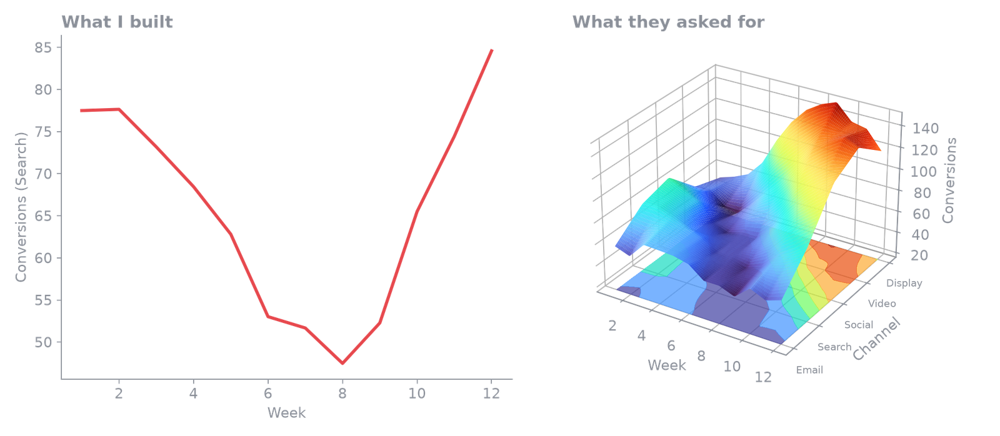

I am a backend engineer. Pipelines, retrieval, evaluation and agent loops are the parts I know. The frontend is the part I used to hand off or skip, and until this year I had shipped almost nothing a user could click.

That became easy to ignore once coding agents could produce a working web page in an afternoon. This year I built a chatbot, and the frontend was the quick part. I started with [Chainlit](https://github.com/Chainlit/chainlit), an open-source Python package for building conversational AI apps, so the whole interface was Python. I checked that it displayed the answers, and went back to the backend.

Later I moved to [assistant-ui](https://github.com/assistant-ui/assistant-ui), an open-source TypeScript and React library for chat interfaces. Chainlit's fixed layout had started to constrain what I could build. assistant-ui comes with many templates and pre-built components, and it gave me more room for interactive pieces such as buttons, animations and guided user tours.

The demo showed me that "displays the answers" is a low bar. This post is about what I changed my mind on, and the one idea from UX research that made the change concrete.

## The comment about the charts

During a demo of the assistant, one of the viewers said the graphs were not fancy enough. They wanted something like 3D plots.

My first reaction was that 3D plots are worse charts. A third axis on a bar or line chart hides values behind other values and makes them harder to read. I still think that.

But the comment was not about reading values. The viewer was reacting to how the product felt, and the backend work behind it (the retrieval, the checks on the numbers) was invisible to them. They could only see the screen. A correct answer in a plain chart looked the same to them as a correct answer in any other tool.

## Substance and the feeling of substance

The backend gives a product its substance: whether the answer is right, whether it is grounded, whether it holds up on the hundredth query. The frontend decides whether anyone is interested enough to find that out.

I do not want to overstate this. A polished interface on top of wrong answers fails the first time someone checks a number. But the reverse also fails. A correct system that looks unfinished gets less attention, fewer trials and less patience, and the first impression is formed before any of the correctness can show.

## The wait is part of the interface

The place where this matters most for AI systems is latency. An assistant that retrieves, calls tools and then writes an answer can take a long time to reply. Depending on the query, mine takes from 13 seconds to 10 minutes.

I could not remove that time without changing the backend, so I looked at how people experience waiting. The article that started this for me is "Beyond the Wait", a summary of research on loading times by a UX psychologist.[^1] Three points from it changed how I built the screen:

- **Attention.** When people are occupied with something, they monitor the clock less, and the wait feels shorter. The article cites an attention-gate model from Block and Zakay (1996) for this.
- **Passive animation can backfire.** It cites a study (Zhao and colleagues, 2017) where a passive animated loading screen increased perceived wait time compared to a blank screen. A spinner that only spins is a passive animation.
- **Match the wait.** In a study by Cheng and colleagues (2023), 105 university students used a simulated mobile app with loading screens of 2, 5 and 10 seconds. At 5 and 10 seconds they preferred interactive animations. At 2 seconds they found them too busy.

The same article warns that overly complex stimuli can overload people and make the wait feel longer, and that it describes the Cheng result as a starting point. These were short waits in a simulated app, with students, so I treat them as a direction and not a rule. None of the studies tested a chat assistant, but I believe they apply.

## Showing the work

An assistant is a different kind of wait from a loading ring, because the system is doing something the user can understand. So instead of a spinner, I show what it is doing while it works: that it is looking up the data, that it is checking a figure, that it is drafting the reply. Claude Code does a similar thing when it prints its thinking and tool calls as it goes.

<!-- fig:wait -->

<svg viewBox="0 0 560 150" xmlns="http://www.w3.org/2000/svg" role="img" aria-label="Animation of two loading states for the same wait. On the left, a single dot pulses and gives the user nothing to read. On the right, three short status lines appear one at a time: looking up the data, checking the totals, drafting the reply." style="width:100%;height:auto;font-family:inherit">

<text x="24" y="26" font-size="15" font-weight="700" text-anchor="start" fill="currentColor" fill-opacity="1">Dot only</text>
<text x="304" y="26" font-size="15" font-weight="700" text-anchor="start" fill="#e5484d" fill-opacity="1">Status lines</text>
<circle class="fl-dot" cx="32" cy="61" r="8" fill="currentColor"/>
<text x="52" y="66" font-size="15" font-weight="400" text-anchor="start" fill="currentColor" fill-opacity="0.6">waiting</text>
<text class="fl-a" x="304" y="66" font-size="15" font-weight="400" text-anchor="start" fill="currentColor" fill-opacity="1">Looking up the data</text>
<text class="fl-b" x="304" y="96" font-size="15" font-weight="400" text-anchor="start" fill="currentColor" fill-opacity="1">Checking the totals</text>
<text class="fl-c" x="304" y="126" font-size="15" font-weight="400" text-anchor="start" fill="currentColor" fill-opacity="1">Drafting the reply</text>
</svg>

I think this helps for three reasons, and only the first is supported by the research above.

1. The user has something to read, which keeps attention busy.
2. The wait has visible progress, so it is clear the system has not stalled.
3. The user can see how the answer was reached, which makes it easier to trust or to correct.

The same caution applies as in the article. Notes that scroll past too fast, or that repeat internal details no user cares about, become the busy stimulus that makes waiting worse. I keep them short and in plain language.

## Where this stops

None of this fixes a slow system. A reply that takes too long is a backend problem, and a good loading experience should not be the reason to stop working on it. Polish also costs time, and I still think a backend engineer's first hour is better spent on the backend.

If I had to give one practical suggestion, it would be to watch someone use your demo without explaining anything, and note what they react to. For me it was a chart and a wait, and neither was in the part of the system I had spent the most time on.

[^1]: Maria Panagiotidi, ["Beyond the Wait: Enhancing User Experience Through Psychological Insights"](https://uxpsychology.substack.com/p/beyond-the-wait-enhancing-user-experience), UX Psychology, March 2024.
